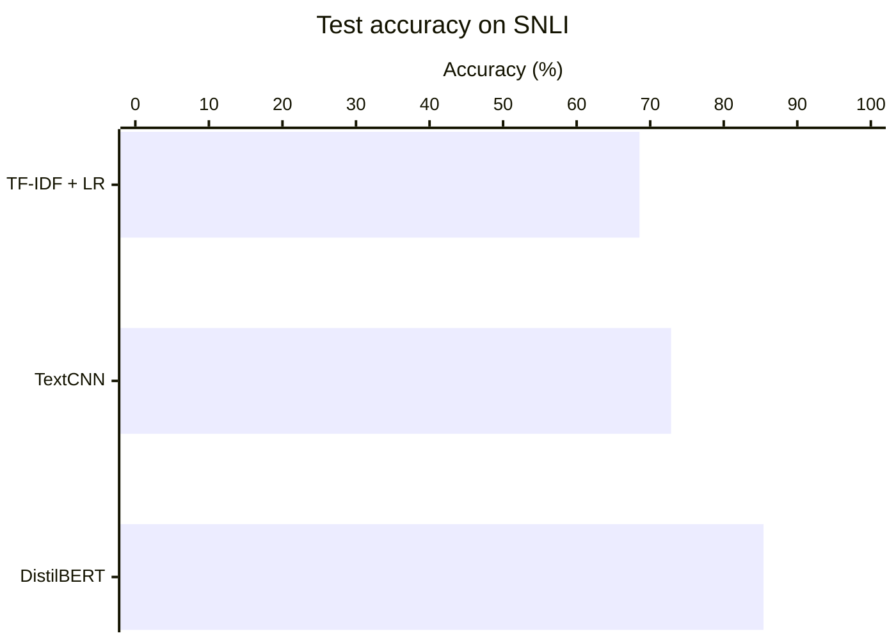

# Natural Language Inference on SNLI

Three approaches to classifying the relationship between two sentences:
TF-IDF with logistic regression, TextCNN, and fine-tuned DistilBERT.

## The task

Given a premise, determine whether a hypothesis follows from it,
contradicts it, or cannot be established from the available information.

> **Premise:** A woman is playing the violin.

| Hypothesis | Label |
| :--- | :--- |
| A person is playing an instrument. | Entailment |
| Nobody is playing an instrument. | Contradiction |
| The woman is a professional musician. | Neutral |

## Results

All models used the same **100,000 training pairs**, with **9,840 validation**
and **9,824 test pairs**.

| Model | Test accuracy | Test macro-F1 |
| :--- | ---: | ---: |
| TF-IDF + Logistic Regression | 68.55% | 0.6851 |
| TextCNN | 72.84% | 0.7278 |
| **DistilBERT** | **85.40%** | **0.8537** |

TextCNN was trained from scratch; DistilBERT was fine-tuned from pretrained
weights. Logistic regression used five-fold grouped cross-validation to
select regularization. Neural checkpoints were selected by validation macro-F1.

These results compare the selected configurations, with one training run
per neural model.